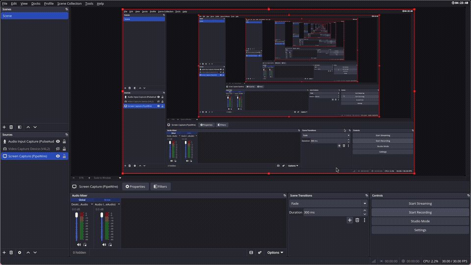

<div align="center">

# 📌 Gemini Pinboard

**Spatial Pin Dispenser & Vertical Line Bookmarking for Google Gemini**

[](https://developer.chrome.com/docs/extensions/mv3/intro/)
[](LICENSE)
[](#architecture)
[](#architecture)
[](#design-system)

<p align="center">
  Stop endlessly scrolling through 10,000-word Gemini sessions. Grab a pin from the floating dispenser pill, drag a glowing vertical laser guide over any line or turn, drop to bookmark, and glide back smoothly anytime.
</p>

<p align="center">
  
</p>

</div>

---

## 🌟 Why Gemini Pinboard?

Standard note-taking extensions extract text snippets into cluttered floating cards, severing the content from its original context. When having long research, code generation, or reasoning sessions in Google Gemini, you don't just want copied text—**you need to navigate back to the exact conversational moment where an idea happened.**

**Gemini Pinboard** introduces a **spatial interaction model**:
- **Drag & Drop Laser Ruler**: Grab a pin from the top-right dispenser bucket; a horizontal guide line tracks your cursor vertically across the chat.
- **Zero-Clutter Index**: Dropping a pin records an instant single-line bookmark (`ping1`, `ping2`, or your custom label) with timestamps, inline renaming, and deletion.
- **Arrival-Synchronized Visual Flash**: Clicking any bookmark smoothly glides Gemini's view to that exact line and fires an eye-locking light blue laser pulse that **waits until you arrive**.
- **Sliding-Window Auto-Recovery**: Overcomes Gemini's dynamic DOM virtualization. If you jump to a pin in an older portion of the chat that Gemini closed/unloaded, the extension automatically detects the unmounted turn, triggers Gemini's loader, and glides right to it.

---

## 🚀 Key Features

| Feature | Description |
| :--- | :--- |
| **📌 Spatial Pin Dispenser** | Fixed top-right pill (`top: 20px; right: 24px`) with a grab-ready pushpin bucket and a live count badge. |
| **⚡ 60fps Laser Drag Engine** | Hardware-accelerated pointer tracking using GPU `translate3d` with zero layout thrashing. |
| **🏷️ Instant Naming Popover** | Drops prompt a sleek inline input pre-filled with incrementing defaults (`ping1`, `ping2`, ...). Press `Enter` to accept or type a custom heading. |
| **📜 Scrollable Single-Line Dock** | Clean, distraction-free dropdown list. Rows never squish or compress—smooth custom scrollbar activates automatically for > 8 pins. |
| **🎯 Sub-Pixel Anchor Engine** | Dual vertical anchoring pairs the container's absolute scroll offset with a fine-grained DOM leaf fingerprint (`<p>`, `<code>`, `<li>`). |
| **💫 Arrival-Synced Light Blue Glow** | The arrival confirmation line stays armed during transit and only triggers its 1.7s solid glow + 0.6s fade **after your viewport has reached the line**. |
| **🔄 Gemini DOM Virtualization Recovery** | Automatically navigates and observes DOM mutations when older chat turns need to be dynamically loaded from the server. |
| **🛡️ Shadow DOM Isolation** | The entire interface mounts inside an isolated `ShadowRoot` (`mode: 'open'`), guaranteeing zero CSS bleeding or interference from Google Gemini's Tailwind styles. |
| **🔒 Context Invalidation Shield** | Mirrors all state synchronously to `localStorage` alongside `chrome.storage.local`. Reloading the extension in Developer Mode never crashes your open tabs. |

---

## 🏗️ Architecture & Engineering

```
┌─────────────────────────────────────────────────────────────┐
│                     Google Gemini Tab                       │
│                                                             │
│  [ ms-chat-turn / model-response / infinite-scroller ]      │
│                                                             │
│   ┌─────────────────────────────────────────────────────┐   │
│   │ <gemini-pinboard-host> (Isolated Shadow DOM)        │   │
│   │                                                     │   │
│   │   [📌 Dispenser Pill]   [Dropdown Scrollable List]  │   │
│   │            │                        │               │   │
│   │      pointerdown                 click              │   │
│   │            ▼                        ▼               │   │
│   │   [Laser Guide Line]       [Smooth Jump Engine]     │   │
│   │            │                        │               │   │
│   │         pointerup                   │               │   │
│   │            ▼                        ▼               │   │
│   │   [Naming Popover]         [Arrival Sync & Flash]   │   │
│   └─────────────────────────────────────────────────────┘   │
│                                │                            │
│                 ┌──────────────┴──────────────┐             │
│                 ▼                             ▼             │
│       chrome.storage.local            window.localStorage   │
│       (Reactive Sync)                 (Instant Fallback)    │
└─────────────────────────────────────────────────────────────┘
```

### Dynamic Scroll Container Detection
`window` is **not** the scrolling element on `gemini.google.com`. Gemini wraps conversations inside custom scroll containers (`infinite-scroller`, deep `<main>` elements, or `.chat-history`).
- The extension ascends from active conversation turns (`model-response`, `user-query`, `message-content`) and inspects computed `overflowY === 'auto' | 'scroll'` with `scrollHeight > clientHeight`.
- Pins are stored per conversation URL: `gemini_pinboard_pins_${chatId}`. Switching conversations via Gemini's SPA router smoothly loads that conversation's pins with zero page reloads.

---

## 📦 Installation (30 Seconds)

### Option 1: Load Unpacked in Chrome / Brave / Edge

1. **Clone the repository**:
   ```bash
   git clone https://github.com/basantbansal/gemini-pinboard.git
   ```
2. Open your Chromium browser and navigate to:
   - **Chrome**: `chrome://extensions/`
   - **Brave**: `brave://extensions/`
   - **Edge**: `edge://extensions/`
3. Toggle on **Developer mode** in the top-right corner.
4. Click **Load unpacked** in the top-left corner.
5. Select the cloned `gemini-pinboard` folder.
6. Open [gemini.google.com](https://gemini.google.com) and start bookmarking!

---

## ⌨️ Controls & Interaction Guide

| Action | How to Trigger |
| :--- | :--- |
| **Grab Pin** | Press and hold on the **📌 Pushpin** bucket in the top-right corner. |
| **Laser Guide Ruler** | Drag your cursor vertically over the chat to view the alignment line. |
| **Cancel Drag** | Press <kbd>Escape</kbd> or drag back over the dispenser pill. |
| **Drop & Bookmark** | Release the mouse at any vertical position. |
| **Confirm Default Name** | Press <kbd>Enter</kbd> (or click **Save**) to accept `ping1`, `ping2`, etc. |
| **Custom Bookmark Heading** | Type your desired title into the popover and press <kbd>Enter</kbd>. |
| **Jump to Pin** | Click any pin row in the dropdown list or click the tick marker on the right margin. |
| **Rename Pin** | Click the **✎** pencil icon on any row to edit inline. |
| **Delete Pin** | Click the **×** button on any row or hover-badge. |
| **Toggle Menu** | Click the right side of the dispenser pill (counter badge & chevron). |

---

## 🎨 Design System

Styled according to modern minimalist product software design guidelines (inspired by **Linear** and **Raycast**):

- **Palette**: Surface `#1e1f20`, Elevated hover `#2b2c2f`, Border `rgba(255, 255, 255, 0.08)`, Text `#e3e3e3`, Muted `#9aa0a6`.
- **Laser & Flash Accent**: Soft, eye-pleasing light blue (`rgba(147, 197, 253, ...)`) providing clean contrast without visual distraction.
- **Typography**: System font stack (`-apple-system, BlinkMacSystemFont, "Segoe UI", Roboto, sans-serif`), weights 400 and 500 only. Tabular monospace numbers for timestamps.
- **Zero Distraction**: No saturated neon gradients, no bounce physics, and no emojis in UI labels. Clean 2px inline SVGs.

---

## 🔒 Privacy & Local-First Security

- **100% Local**: All pin labels, timestamps, and scroll coordinates are stored strictly inside your browser's local sandbox (`chrome.storage.local` and `localStorage`).
- **Zero Network Requests**: Does not make external network requests, send telemetry, track usage, or communicate with remote servers.
- **Zero Untrusted HTML**: Safe DOM element construction (`createElement`, `textContent`) preventing XSS.

---

## 📄 License

Distributed under the **MIT License**. See [`LICENSE`](LICENSE) for details.

---

<div align="center">
  <sub>Crafted with precision for productive minds navigating long AI conversations.</sub>
</div>
